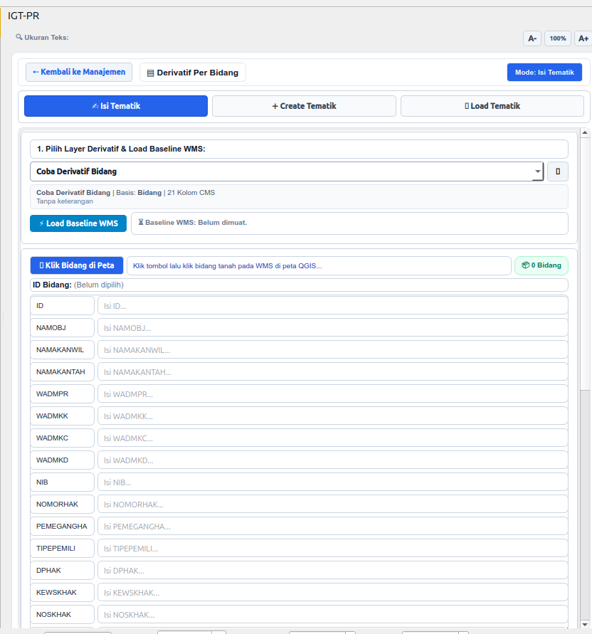
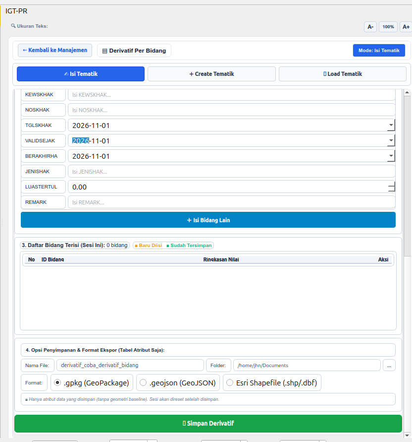
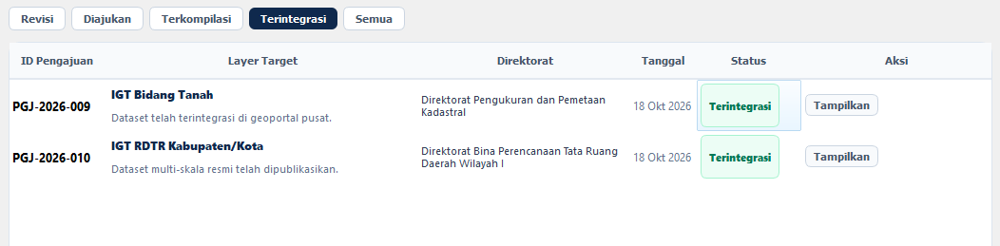

# Review Lutfi

Kustom tematik derivative tapi munculnya model builder, mungkin perlu supaya tidak membingungkan

Langsung muncul seperti ini saja:

Jadi case nya:

Ketika ada pengajuan dan sudah sampai tahap Kopilasi, akan Integrasi data di web (admin/superadmin klik Cek Topology) datanya muncul ke Plugin. Di dalam plugin admin/superadmin melakukan pengecekan topology dan verifikasi

Ketika ada pengajuan revisi, nanti prosesnya sama seperti poin 1
