# Revisi QGIS

Icon di katalog IGT bisa diganti jadi nomor

Tulisan nama IGT tidak usah di-bold

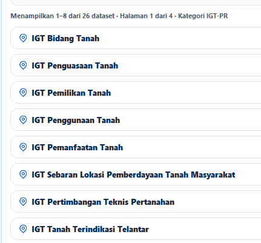

Tidak usah ada chip pertanahan/ tata ruang lagi, ganti jadi icon aja biar lebih ringkas. Peletakannya juga disatuin sama nama IGT aja

Ada pilihan load keduanya

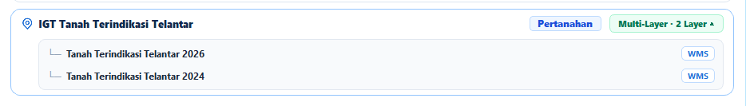

Filternya dibikin satu row aja, di kiri pencarian di kanan klik filter (kalo di klik filter baru muncul pilihan prov dan kab/kot)

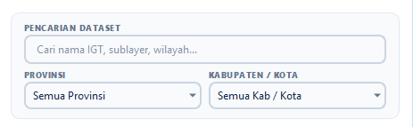

Ketika klik unggah langsung muncul popup seperti ini

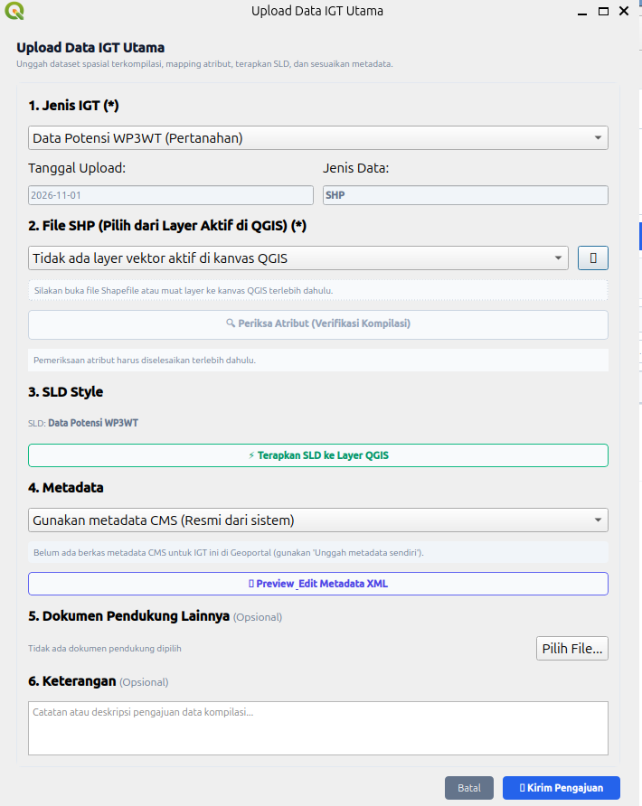

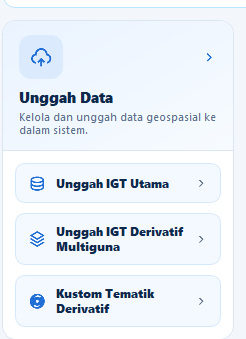

Kolom kategori dihapus saja

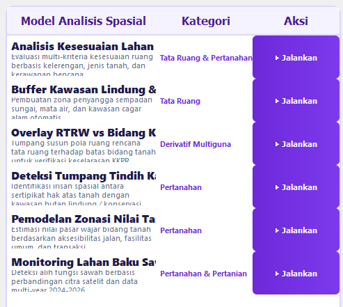

Untuk superadmin, tabnya adalah: Cek Topologi, Diajukan, dan Revisi

Untuk admin: sama dengan superadmin

Untuk operator: Revisi, Diajukan, Terkompilasi, Terintegrasi, dan Semua

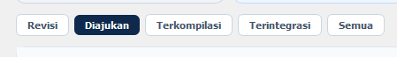

Pilihan manajemen IGT:

Superadmin: IGT Utama, IGT Derivatif Multiguna

Admin: IGT Utama dan IGT Derivatif

Operator: IGT Utama dan IGT Derivatif Multiguna

Umum: hanya IGT Derivatif Multiguna

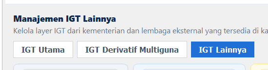

Pengguna umum juga punya akses ke model builder sama custom/load tematik derivatif

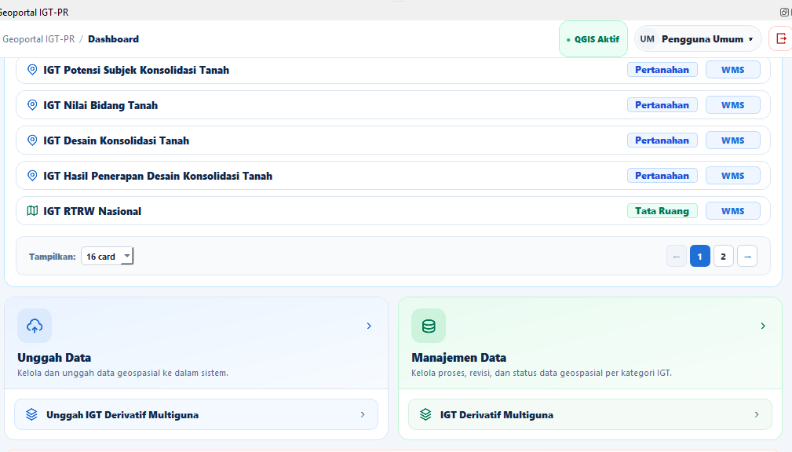

Tombol kompilasi dan setujui di IGT Utama dihapus saja, itu sudah ada di web IGT-PR. QGIS fokus ke cek topologi.

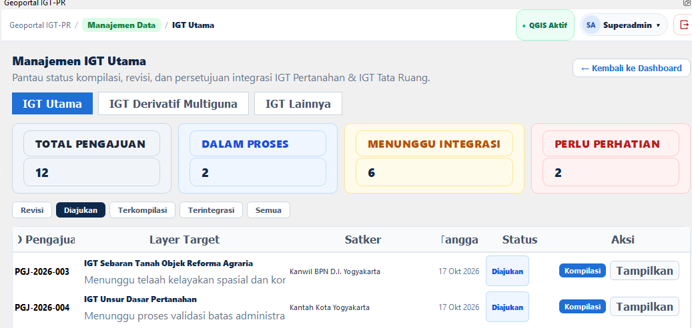

Manajemen IGT lainnya ini dihapus aja di semua role, upload IGT lainnya melalui web, utk load peta di klik di katalog

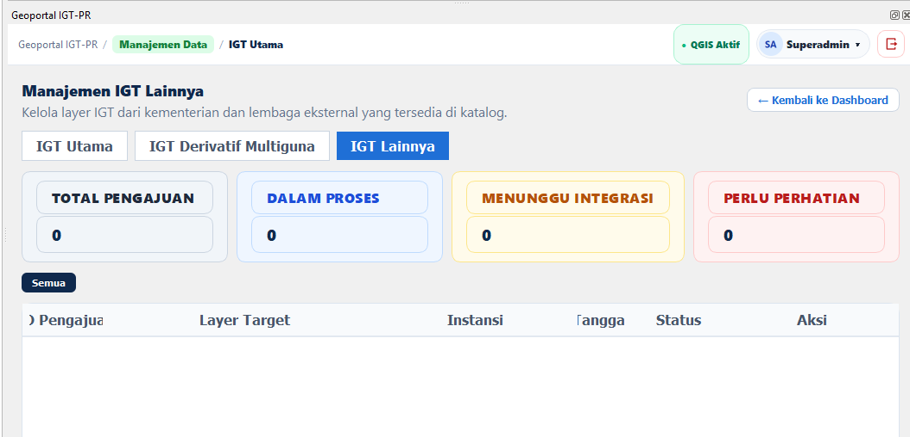

Bagian ini dihapus aja, seakan2 ada data yg ga perlu perhatian

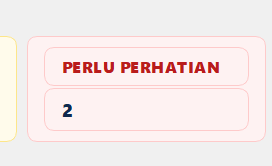

Judulnya sesuaikan lagi, lebih tepat disebut IGT-PR Plugin

Subjudul juga bikin penyesuaian

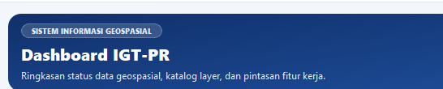

Kalo Tanda > dihapus saja

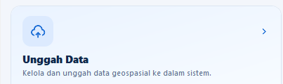
